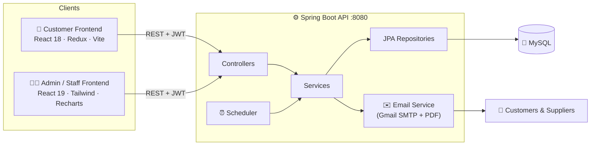
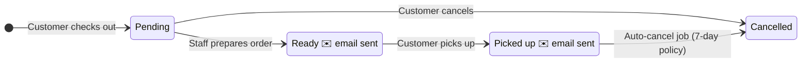

<div align="center">


<a href="#">
  
</a>

<br/>


<br/>

**A complete web system for a vehicle spare parts shop** — an online parts store for customers,<br/>
and role-based dashboards for the manager, cashier and store keeper, all on one Spring Boot API.

[✨ Features](#-features) · [🏗️ Architecture](#️-architecture) · [🚀 Getting Started](#-getting-started) · [🔌 API](#-api-overview) · [👥 Team](#-team)

</div>

---

## 📖 Table of Contents

- [About the Project](#-about-the-project)
- [Features](#-features)
- [User Roles](#-user-roles)
- [Architecture](#️-architecture)
- [Tech Stack](#️-tech-stack)
- [Project Structure](#-project-structure)
- [Getting Started](#-getting-started)
- [Configuration](#️-configuration)
- [API Overview](#-api-overview)
- [Order Lifecycle](#-order-lifecycle)
- [Team](#-team)

---

## 🏍️ About the Project

**Madara Motors Web System** digitalises the day-to-day work of a vehicle spare parts business. It brings together three apps:

<table>
<tr>
<td width="33%" align="center">
<h3>🛒</h3>
<b>Customer Storefront</b><br/>
<sub>Browse parts by vehicle type, brand and model, add them to a cart, check out and track orders.</sub>
</td>
<td width="33%" align="center">
<h3>🧑‍💼</h3>
<b>Staff Portal</b><br/>
<sub>Separate dashboards for the Manager, Cashier and Store Keeper, with OTP-secured login.</sub>
</td>
<td width="33%" align="center">
<h3>⚙️</h3>
<b>REST API</b><br/>
<sub>Spring Boot backend with JWT auth, email notifications, PDF purchase orders and scheduled jobs.</sub>
</td>
</tr>
</table>

---

## ✨ Features

<details open>
<summary><b>🛒 Customer Storefront</b></summary>
<br/>

| Feature | Description |
|---|---|
| 🔍 **Parts Catalog** | Search and filter by vehicle type (Car, Van, SUV, Lorry…), brand, model and category |
| 📄 **Product Details** | Price, stock availability, compatibility info and customer reviews ⭐ |
| 🛍️ **Cart & Checkout** | Persistent cart with a smooth checkout flow |
| 📦 **My Orders** | Track order status and cancel eligible orders |
| 🔐 **Auth** | Email + password registration with OTP email verification |
| 🌐 **Social Login** | Sign in with **Google** or **Facebook** |
| 🔑 **Password Recovery** | Forgot password → OTP → reset |
| 👤 **Profile** | Edit profile details and change email with a confirm/cancel link |

</details>

<details open>
<summary><b>🧑‍💼 Manager Dashboard</b></summary>
<br/>

- 📊 **Analytics overview**: sales charts, top products, sales by category, daily profit
- 📦 **Inventory** management with low-stock alerts
- 🚚 **Suppliers** and **Purchase Orders**, with the PO emailed to the supplier as a **PDF**
- 🧾 **Orders** & **Customers** management
- 👥 **User (staff) management**: create accounts and approve account activation requests
- 📑 **Reports**: GRN history, returns and damaged items
- 🔔 Real-time style **notifications** with approve / reject / dismiss actions

</details>

<details>
<summary><b>💵 Cashier Dashboard</b></summary>
<br/>

- 🖥️ **Point of Sale (POS)** for walk-in sales with bill lookup
- 🔁 **Returns** handling (RMA)
- 🧩 **Vehicle compatibility** search for parts
- 🕘 **Sales history** & **profit** view
- 📨 Send stock requests to the manager

</details>

<details>
<summary><b>🏬 Store Keeper Dashboard</b></summary>
<br/>

- 📥 **Inward stock / GRN** entry
- 📉 **Low-stock** and **out-of-stock** monitoring
- ⚠️ **Damaged items** recording
- 🧩 Vehicle compatibility lookup
- 📦 Full inventory view with stock updates

</details>

<details>
<summary><b>🔒 Security & Automation</b></summary>
<br/>

- 🔐 **JWT** authentication (24h tokens) + Spring Security
- ✉️ **OTP verification** for staff login and customer sign-up
- 🚫 Account lock & activation-request flow
- 📧 Automated HTML emails: OTP, welcome, *order ready*, *order picked up*, purchase orders
- ⏰ **Scheduled job** runs daily at midnight to auto-cancel stale orders (7-day policy)

</details>

---

## 👥 User Roles

| Role | Portal | Main Responsibilities |
|:---:|:---:|---|
| 👑 **Manager** | `/manager-dashboard` | Analytics, inventory, suppliers, purchase orders, staff, reports |
| 💵 **Cashier** | `/cashier-dashboard` | POS billing, returns, sales history, compatibility lookup |
| 🏬 **Store Keeper** | `/store-dashboard` | GRN / inward stock, low-stock & damaged items |
| 🙋 **Customer** | Storefront | Browse, buy, review and track orders |

---

## 🏗️ Architecture



---

## 🛠️ Tech Stack

<table>
<tr><th>Layer</th><th>Technologies</th></tr>
<tr>
<td><b>Backend</b></td>
<td>
<br/>
Spring Boot 3.2 · Spring Data JPA · Spring Security · Spring Mail · Validation · JJWT · Thymeleaf · OpenPDF / Flying Saucer
</td>
</tr>
<tr>
<td><b>Admin Frontend</b></td>
<td>
<br/>
React 19 · Vite 7 · Tailwind CSS 4 · Framer Motion · Recharts · Lucide Icons · Axios
</td>
</tr>
<tr>
<td><b>Customer Frontend</b></td>
<td>
<br/>
React 18 · Redux Toolkit · React Router · Google OAuth · Facebook Login · date-fns · Axios
</td>
</tr>
<tr>
<td><b>Database</b></td>
<td><br/>MySQL (Hibernate auto schema update)</td>
</tr>
<tr>
<td><b>Tools</b></td>
<td></td>
</tr>
</table>

---

## 📁 Project Structure

```text
Madara_Motos_WEBSysterm/
├── 📂 backend/                    # Spring Boot REST API
│   ├── src/main/java/com/example/backend/
│   │   ├── config/                # Security & CORS
│   │   ├── controller/            # REST endpoints (18 controllers)
│   │   ├── dto/                   # Request / response objects
│   │   ├── entity/                # JPA entities (SparePart, Order, Supplier, ...)
│   │   ├── repository/            # Spring Data repositories
│   │   ├── service/               # Business logic, email, scheduler
│   │   └── util/                  # JWT & OTP helpers
│   ├── src/main/resources/application.properties
│   └── pom.xml
│
├── 📂 admin fronted/              # Staff portal (Manager / Cashier / Store)
│   └── src/
│       ├── components/            # Dashboard widgets, charts, tables
│       └── pages/                 # Login, OTP, Manager, Cashier, Sales dashboards
│
└── 📂 customer_frontend/          # Customer online store
    └── src/
        ├── pages/                 # Home, Catalog, Cart, Checkout, Orders, Profile
        ├── context/               # Auth & Cart context
        ├── routes/                # Protected routes
        └── services/api.js        # Axios API client
```

---

## 🚀 Getting Started

### ✅ Prerequisites

| Tool | Version |
|---|---|
| ☕ JDK | 17+ |
| 🟢 Node.js | 18+ |
| 🐬 MySQL | 8.x |
| 📦 Maven | bundled `mvnw` wrapper |

### 1️⃣ Clone the repository

```bash
git clone https://github.com/kavindugayasiri/Madara_Motors_web_System.git
cd Madara_Motors_web_System/Madara_Motos_WEBSysterm
```

### 2️⃣ Run the backend

```bash
cd backend
# configure application.properties first (see Configuration below)
./mvnw spring-boot:run        # Windows: mvnw spring-boot:run
```

> 🟢 API runs at **http://localhost:8080**. The database `Project1` is created automatically.

### 3️⃣ Run the Admin / Staff frontend

```bash
cd "admin fronted"
npm install
npm run dev
```

> 🟢 Opens at **http://localhost:3000**
>
> 💡 Tip: `npm run start-all` starts the backend and admin frontend together.

### 4️⃣ Run the Customer frontend

```bash
cd customer_frontend
npm install
npm run dev
```

> 🟢 Opens at **http://localhost:5173**

---

## ⚙️ Configuration

### Backend: `backend/src/main/resources/application.properties`

```properties
# Database
spring.datasource.url=jdbc:mysql://localhost:3306/Project1?createDatabaseIfNotExist=true&useSSL=false&allowPublicKeyRetrieval=true
spring.datasource.username=YOUR_DB_USER
spring.datasource.password=YOUR_DB_PASSWORD

# JWT
app.jwt.secret=YOUR_LONG_RANDOM_SECRET
app.jwt.expiration=86400000

# Gmail SMTP (use a Gmail App Password)
spring.mail.username=your-email@gmail.com
spring.mail.password=YOUR_APP_PASSWORD
```

### Customer frontend: `customer_frontend/.env`

```env
VITE_GOOGLE_CLIENT_ID=your-google-oauth-client-id
VITE_FACEBOOK_APP_ID=your-facebook-app-id
```

> ⚠️ **Never commit real passwords, secrets or API keys.** Keep them in environment variables or a local file listed in `.gitignore`.

---

## 🔌 API Overview

Base URL: `http://localhost:8080`

| Module | Endpoint | Purpose |
|---|---|---|
| 🔐 Staff Auth | `/api/auth` | Login, OTP verify/resend, forgot/reset password, activation request |
| 🙋 Customer Auth | `/api/customer/auth` | Register, login, verify email, Google / Facebook login |
| ✉️ Email Change | `/api/email-change` | Request, confirm and cancel email changes |
| 🔩 Spare Parts | `/api/spareparts` | Search, filter, by brand / vehicle, compatibility, low stock |
| 📦 Products | `/api/products` | Add, update, update stock, delete |
| 🧾 Orders | `/api/orders` | Place, update status, cancel, customer orders |
| 💵 Sales | `/api/sales` | POS sales, bill lookup, daily profit |
| 🔁 Returns | `/api/returns` | Return requests |
| ⚠️ Damaged | `/api/damaged` | Damaged item records |
| 🚚 Suppliers | `/api/suppliers` | Supplier CRUD |
| 📝 Purchases | `/api/purchases` | Purchase orders (emailed as PDF) |
| 📥 GRN History | `/api/grn-history` | Goods received notes |
| ⭐ Reviews | `/api/reviews` | Product reviews |
| 🔔 Notifications | `/api/notifications` | Pending requests: approve / reject / dismiss |
| 👥 Users | `/api/users` | Staff accounts, profile, status |
| 📊 Dashboard | `/api/manager-dashboard` | Manager analytics |

---

## 🔄 Order Lifecycle



---

## 👥 Team

<div align="center">

<table>
<tr>
<td align="center" width="220">
<a href="https://github.com/kavindugayasiri">
<br/>
<b>Kavidu Gayasiri Bandara</b>
</a><br/>
<sub>Full-Stack Developer</sub>
</td>
<td align="center" width="220">
<br/>
<b>Oshadhi Harindya Senarathna</b><br/>
<sub>Full-Stack Developer</sub>
</td>
</tr>
</table>

🎓 *HND in Software Engineering · NIBM*

</div>

---

<div align="center">

Made with ❤️ by **Kavidu Gayasiri Bandara** & **Oshadhi Harindya Senarathna**

⭐ Star this repo if you found it helpful!


</div>
